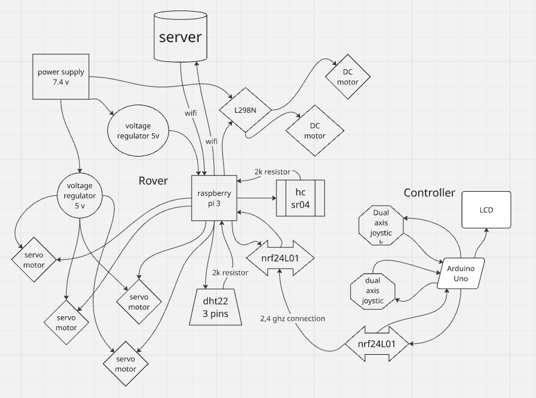

# examproject
Full stack project for our 2. semester exam. A physical rover that is controlled over the network via a web interface.

The rover has two brains. The motors and sensors runs on an Arduino Uno, and the camera, vision and communication runs on the Raspberry Pi 3. We've set up a backend server and a frontend for manual control via WASD and a live video feed. The video feed won't be archived, but the sensor data such as temperature and colour will be archived, which is handled by the backend.

## Structure

## Sources

### PiCore
- [Increasing Raspberry Pi FPS with Python and OpenCV](https://pyimagesearch.com/2015/12/28/increasing-raspberry-pi-fps-with-python-and-opencv/) - CameraManager class and threaded capture loop adapted from this tutorial for camera_manager.py
- [Raspberry Pi Arduino Serial Communication](https://roboticsbackend.com/raspberry-pi-arduino-serial-communication/) - Port and baud rate values for UNO adapted from this tutorial for config.py
- [The Picamera2 Library](https://datasheets.raspberrypi.com/camera/picamera2-manual.pdf) - Picamera2 API adapted from this manual for camera_manager.py
- [picamera2 MJPEG server example](https://github.com/raspberrypi/picamera2/blob/main/examples/mjpeg_server.py) - Streaming pattern adapted from this example for video_stream.py
